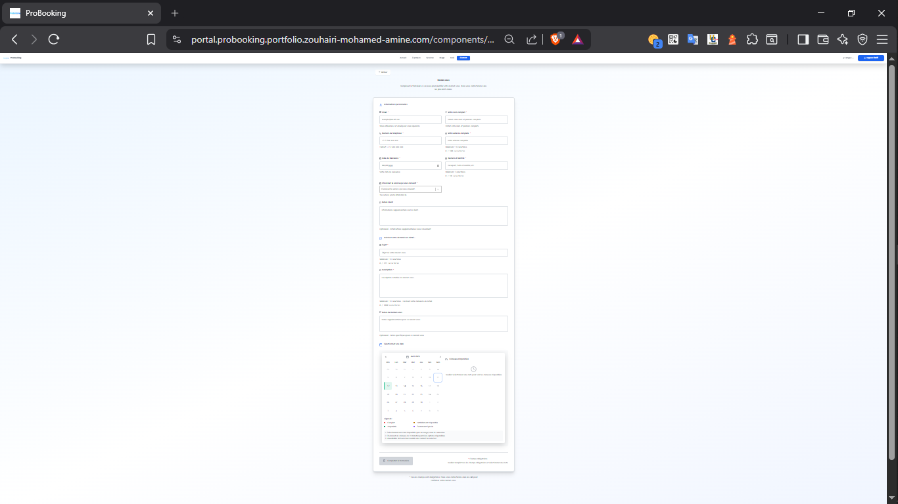
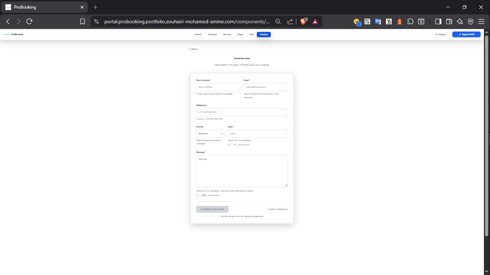
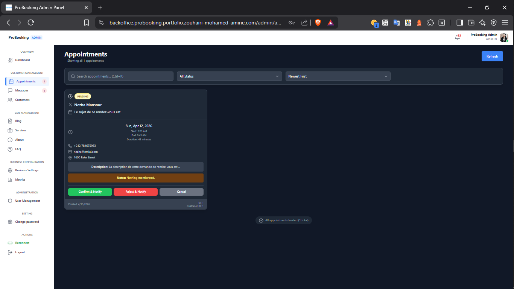
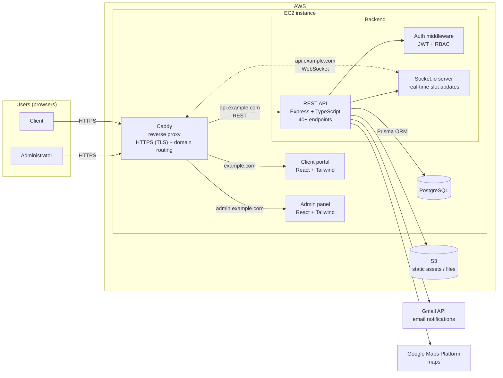

# Real-Time Appointment Booking Platform

A full stack web platform that lets clients book appointments in real time and gives administrators a dashboard to manage bookings request, the public web site content (CMS), customer data, contact message, and users. Built end to end for a commercialisation purpose, from requirements to production on AWS.

<!-- TODO: one line on the client's business, e.g. "Built for a medical clinic to replace phone-only booking." -->

Built for professional on the domaine of law (notary, and lawyer)

**Live demo:https://probooking.duckdns.org <!-- TODO: link, or "available on request" -->
**Video walkthrough (1 min 42s):https://youtu.be/ywbkszYtptM** <!-- TODO: Loom / YouTube link -->





<!-- TODO: add 2-3 anonymized screenshots (client view, admin dashboard) -->

---

## Features

**Client side**

- Browse available time slots and book an appointment in real time
- Slots update instantly for every connected user when someone books (no double booking)
- Email confirmation and notifications
- Contact form to reach out the business for query or relevant needs
- Navigate through the public web site to discover, or pick any needed business's related information

**Admin side**

- Dashboard to manage appointments, contact messages, customer information, CMS, and users
- Role-based access control (admin / staff )
- Preview page of the new data from the Portal

---

## Tech Stack

| Layer           | Technologies                                            |
| --------------- | ------------------------------------------------------- |
| Frontend        | React, TypeScript, Tailwind CSS                         |
| Backend         | Node.js, Express, TypeScript                            |
| Real time       | Socket.io                                               |
| Database        | PostgreSQL, Prisma ORM                                  |
| Auth & security | JWT, role-based access control (RBAC), input validation |
| Testing         | Jest                                                    |
| Integrations    | Gmail API, Google Platform                              |
| Cloud           | AWS (EC2, S3)                                           |

---

## Architecture



<!-- TODO: adjust to the real setup (what S3 stores, which Google services are used) -->

**Request flow for a booking:**

1. The client selects a slot.
2. The API checks availability and saves the booking in PostgreSQL inside a transaction, preventing double booking.
3. The Socket.io server broadcasts the update, so every user sees the slot as taken instantly.
4. A confirmation email is sent through the Gmail API.

---

## Key Technical Decisions

- **Socket.io for real time:** availability changes must be visible instantly to avoid two clients booking the same slot. WebSockets push updates instead of making clients poll the API.
- **Prisma with PostgreSQL:** type-safe queries shared with the TypeScript codebase, plus migrations to version the database schema.
- **JWT + RBAC:** stateless authentication that scales across instances, with permissions checked per role on every protected route.
- <!-- TODO: one more decision you are proud of, and why -->

---

## Project Structure

<!-- TODO: replace with the real structure -->

```
├── client/            # React frontend (client + admin)
├── server/
│   ├── src/
│   │   ├── routes/      # Express routes
│   │   ├── controllers/ # Request handlers
│   │   ├── services/    # Business logic
│   │   ├── middleware/  # Auth, validation, error handling
│   │   └── socket/      # Socket.io events
│   ├── prisma/          # Schema and migrations
│   └── tests/           # Jest tests
└── docs/              # Screenshots and diagrams
```

---

## API Overview

<!-- TODO: list 5-6 representative endpoints, or link to Swagger docs -->

| Method | Endpoint                  | Description                    | Access         |
| ------ | ------------------------- | ------------------------------ | -------------- |
| POST   | `/api/auth/login`         | Authenticate and receive a JWT | Public         |
| GET    | `/api/slots`              | List available slots           | Client         |
| POST   | `/api/appointments`       | Book an appointment            | Client         |
| PATCH  | `/api/appointments/:id`   | Reschedule or cancel           | Client / Admin |
| GET    | `/api/admin/appointments` | List all appointments          | Admin          |

---

## Roadmap

- [ ] Containerize with Docker and Docker Compose
- [ ] CI/CD pipeline with GitHub Actions (tests on every pull request, automatic deployment)
- [ ] Appointment reminders with a job queue (Redis + BullMQ)
- [ ] Increase test coverage with integration tests

---

## Author

**Mohamed Amine Zouhairi** — Full Stack Developer (TypeScript, Node.js, React)
[LinkedIn](https://linkedin.com/in/mohamedaminezouhairi) · [GitHub](https://github.com/aminezouh)

> This project was developed for a commercializaton purpose. Shared with permission; sensitive data and business details have been removed.

<!-- TODO: keep this note only if the client agreed; otherwise publish a case study without the code -->
